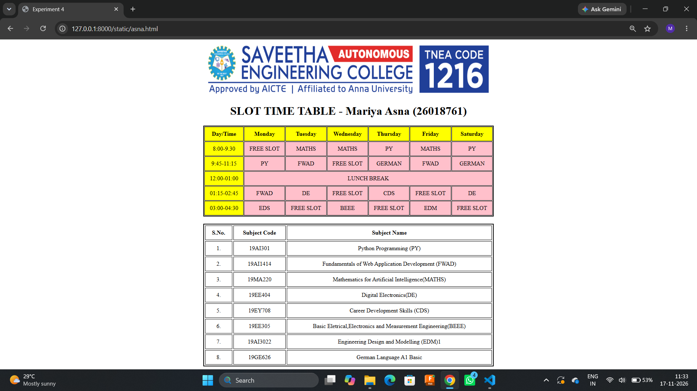

# Ex04 Time Table
## Date:17.11.2026

## AIM
To write a html webpage page to display your slot timetable.

## ALGORITHM
### STEP 1
Create a Django-admin Interface.

### STEP 2
Create an App inside the Django project.

### STEP 2
Create a static folder uder the created App and insert HTML code.

### STEP 3
Create a simple table using ```<table>``` tag in html with the relevant attributes.

### STEP 4
Add rows using ```<tr>``` tag.

### STEP 5
Add your course schedule using ```<td>``` tag.

### STEP 6
Execute the program using runserver command.

## PROGRAM

```
<html>
<head>
    <title>Experiment 4</title>
</head>
<body>
<center>
    
</center>

<h1 align="center">
    SLOT TIME TABLE - Mariya Asna (26018761)
</h1>

<table border="2" cellpadding="10" cellspacing="1" align="center" bordercolor="black" width="800" height="150">

    <tr bgcolor="yellow" align="center">
        <th>Day/Time</th>
        <th>Monday</th>
        <th>Tuesday</th>
        <th>Wednesday</th>
        <th>Thursday</th>
        <th>Friday</th>
        <th>Saturday</th>
    </tr>

    <tr bgcolor="pink" align="center">
        <td bgcolor="yellow">8:00-9.30</td>
        <td>FREE SLOT</td>
        <td>MATHS</td>
        <td>MATHS</td>
        <td>PY</td>
        <td>MATHS</td>
        <td>PY</td>
    </tr>

    <tr bgcolor="pink" align="center">
        <td bgcolor="yellow">9:45-11:15</td>
        <td>PY</td>
        <td>FWAD</td>
        <td>FREE SLOT</td>
        <td>GERMAN</td>
        <td>FWAD</td>
        <td>GERMAN</td>
    </tr>

    <tr bgcolor="pink" align="center">
        <td bgcolor="yellow">12:00-01:00</td>
        <td colspan="6" align="center">LUNCH BREAK</td>
    </tr>

    <tr bgcolor="pink" align="center">
        <td bgcolor="yellow">01:15-02:45</td>
        <td>FWAD</td>
        <td>DE</td>
        <td>FREE SLOT</td>
        <td>CDS</td>
        <td>FREE SLOT</td>
        <td>DE</td>
    </tr>


    <tr bgcolor="pink" align="center">
        <td bgcolor="yellow">03:00-04:30</td>
        <td>EDS</td>
        <td>FREE SLOT</td>
        <td>BEEE</td>
        <td>FREE SLOT</td>
        <td>EDM</td>
        <td>FREE SLOT</td>
    </tr>

</table>

<h2> 


</h2>


<table border="2" cellpadding="10" cellspacing="3" align="center" bordercolor="black" width="800" height="150">
    <tr align="center">
        <th>S.No.</th>
        <th>Subject Code</th>
        <th>Subject Name</th>
    </tr>
    <tr align="center">
        <td>1.</td>
        <td>19AI301</td>
        <td>Python Programming (PY)</td>
    </tr>
    <tr align="center">
        <td>2.</td>
        <td>19AI1414</td>
        <td>Fundamentals of Web Application Development (FWAD)</td>
    </tr>
    <tr align="center">
        <td>3.</td>
        <td>19MA220</td>
        <td>Mathematics for Artificial Intelligence(MATHS)</td>
    </tr>
    <tr align="center">
        <td>4.</td>
        <td>19EE404</td>
        <td>Digital Electronics(DE)</td>
    </tr>
    <tr align="center">
        <td>5.</td>
        <td>19EY708</td>
        <td>Career Development Skills (CDS)</td>
    </tr> 
    <tr align="center">
        <td>6.</td>
        <td>19EE305</td>
        <td>Basic Eletrical,Electronics and Measurement Engineering(BEEE)</td>
    </tr>
    <tr align="center">
        <td>7.</td>
        <td>19AI3022</td>
        <td>Engineering Design and Modelling (EDM)1</td>
    </tr>
    <tr align="center">
        <td>8.</td>
        <td>19GE626</td>
        <td>German Language A1 Basic</td>

    </tr>        
</table>

</body>
</html>

```
## OUTPUT


## RESULT
The program for creating slot timetable using basic HTML tags is executed successfully.
